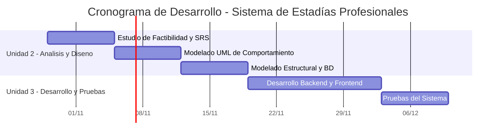

# Estudio de Factibilidad y Planificación del Proyecto

**Asignatura:** Ingeniería de Software  
**Unidad:** 2 - Análisis y Diseño de Sistemas de Software  
**Proyecto:** Sistema de Gestión y Seguimiento de Estadías Profesionales  
**Integrantes:** Arely Rodríguez Vargas y Eder Nieto Aguilar  

## 1. Análisis de Factibilidad Multidimensional

### 1.1 Factibilidad Técnica

El proyecto es técnicamente viable porque se puede desarrollar utilizando herramientas de programación y bases de datos que están al alcance del equipo.

Se propone utilizar Python con Flask para desarrollar las funciones del sistema, HTML y CSS para diseñar la interfaz web y SQLite para almacenar la información de estudiantes, asesores, estadías y evidencias.

También se utilizará Visual Studio Code como entorno de desarrollo y GitHub para organizar los archivos y controlar las modificaciones.

El equipo cuenta con conocimientos básicos de programación, bases de datos y desarrollo de software. Sin embargo, será necesario reforzar algunos conocimientos sobre autenticación de usuarios, manejo de documentos y conexión con la base de datos.

### 1.2 Factibilidad Económica

El proyecto es económicamente viable porque se utilizarán herramientas gratuitas y de código abierto, lo que permitirá reducir los gastos de desarrollo.

Los principales recursos necesarios serán computadoras, conexión a Internet y tiempo de trabajo de los integrantes.

No será necesario comprar sensores ni componentes electrónicos, ya que el proyecto consiste en desarrollar una plataforma web.

Para la primera versión se utilizará una base de datos local y un entorno de pruebas, por lo que no se considera necesario contratar un servidor de pago.

El principal recurso que se invertirá será el tiempo destinado al análisis, diseño, programación y pruebas del sistema.

### 1.3 Factibilidad Operativa

El sistema busca facilitar el seguimiento de las estadías profesionales de los estudiantes y mejorar la organización de actividades, reportes y evidencias.

Los estudiantes podrán registrar sus avances, consultar sus entregas y revisar las observaciones realizadas por sus asesores.

Por su parte, los asesores académicos podrán consultar los reportes de los estudiantes asignados, aprobar entregas y solicitar correcciones.

Se buscará desarrollar una interfaz sencilla para facilitar su uso. También será importante realizar pruebas con usuarios para identificar dificultades y mejorar las funciones.

El sistema deberá proteger los datos personales y académicos de los estudiantes, estableciendo permisos de acceso y medidas de seguridad adecuadas.

Por estas razones, se considera que el proyecto tiene una buena posibilidad de ser utilizado, siempre que sus funciones respondan a las necesidades de estudiantes y asesores.

## 2. Cronograma de Trabajo y Diagrama de Gantt

El desarrollo del Sistema de Gestión y Seguimiento de Estadías Profesionales se organizará mediante diferentes etapas de análisis, diseño, programación y pruebas.

El cronograma permitirá distribuir las actividades del equipo y dar seguimiento a los avances del proyecto.

### Actividades principales

1. **Estudio de factibilidad:** Evaluar los recursos técnicos, económicos y operativos necesarios para desarrollar el sistema.
2. **Especificación de requisitos:** Definir las funciones que tendrá la plataforma y las necesidades de estudiantes y asesores.
3. **Modelado UML:** Diseñar los diagramas que representarán el funcionamiento y estructura del sistema.
4. **Diseño de base de datos:** Definir las tablas y relaciones necesarias para guardar la información.
5. **Desarrollo:** Programar las funciones principales del sistema.
6. **Pruebas:** Verificar que el sistema funcione correctamente y corregir los errores encontrados.

## 3. Matriz de Asignación de Responsabilidades (RACI)

Para organizar las actividades del proyecto, se utilizará una matriz RACI que permita identificar las responsabilidades de cada integrante del equipo.

| Tarea / Entregable | Arely Rodríguez Vargas | Eder Nieto Aguilar |
|---|---|---|
| Estudio de Factibilidad | R | A |
| Redacción SRS IEEE 830 | A | R |
| Diagramas UML | R | A |
| Diseño de Base de Datos | A | R |
| Desarrollo de la Interfaz Web | R | A |
| Desarrollo del Backend | A | R |
| Pruebas del Sistema | R | A |
| Documentación Final | A | R |

**Significado de las letras:**

- **R (Responsable):** Realiza la actividad asignada.
- **A (Aprobador):** Revisa y aprueba el resultado.
- **C (Consultado):** Proporciona información o recomendaciones.
- **I (Informado):** Recibe información sobre el avance.

Debido a que el equipo está formado por dos integrantes, ambos participarán en el desarrollo y revisión de las actividades, distribuyendo las responsabilidades según las necesidades del proyecto.

## 4. Estimación de Costos y Recursos

Para desarrollar el Sistema de Gestión y Seguimiento de Estadías Profesionales, se utilizarán herramientas gratuitas y equipos de cómputo disponibles para los integrantes.

### Recursos Necesarios

| Recurso | Uso | Costo Estimado |
|---|---|---|
| Python y Flask | Desarrollo del sistema | $0 MXN |
| HTML y CSS | Diseño de la interfaz | $0 MXN |
| SQLite | Almacenamiento de información | $0 MXN |
| Visual Studio Code | Programación | $0 MXN |
| GitHub | Control de versiones | $0 MXN |
| Computadoras propias | Desarrollo y pruebas | $0 MXN adicionales |
| Servidor local | Pruebas del sistema | $0 MXN |
| **Total de gastos directos estimados** | | **$0 MXN** |

El costo directo estimado es de $0 MXN porque se utilizarán herramientas gratuitas y equipos que ya están disponibles. No se incluyen gastos de electricidad, Internet ni servicios de alojamiento en producción.

### Estimación de Horas de Trabajo

| Actividad | Horas Estimadas |
|---|---:|
| Análisis de factibilidad y requisitos | 8 |
| Diseño de diagramas UML | 8 |
| Diseño de base de datos | 6 |
| Desarrollo de la interfaz web | 16 |
| Programación del sistema | 20 |
| Pruebas y corrección de errores | 10 |
| Documentación final | 6 |
| **Total** | **74 horas** |

Las 74 horas representan el esfuerzo total estimado del equipo, no las horas individuales de cada integrante.

Para valorar el tiempo invertido, se considera una tarifa hipotética de $100 MXN por hora de trabajo.

**Costo estimado de trabajo:**

74 horas × $100 MXN = $7,400 MXN.

Por lo tanto, aunque no se esperan gastos directos adicionales para desarrollar el prototipo, el valor estimado del trabajo realizado es de $7,400 MXN.

Esta cantidad es una estimación académica y no representa un pago real a los integrantes.
