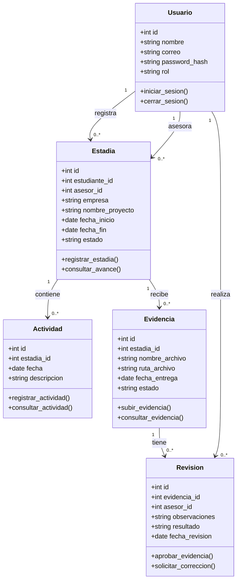
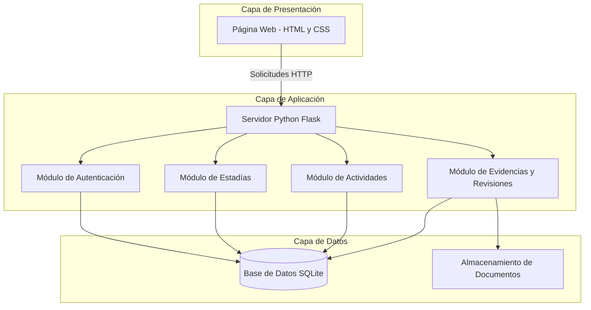

# Modelado Estructural y Diagramas de Arquitectura UML

**Proyecto:** Sistema de Gestión y Seguimiento de Estadías Profesionales

**Asignatura:** Ingeniería de Software

**Unidad:** 2 - Análisis y Diseño de Sistemas de Software

## 1. Diagrama de Clases UML

El diagrama de clases representa los elementos principales del sistema, sus atributos, métodos y las relaciones que existen entre ellos.

Para nuestro proyecto se consideran cinco clases principales: Usuario, Estadia, Actividad, Evidencia y Revision.



### Descripción de las Clases

| Clase | Descripción |
|---|---|
| Usuario | Almacena la información de estudiantes y asesores académicos. |
| Estadia | Guarda los datos de la empresa, proyecto y asesores asignados. |
| Actividad | Registra las actividades realizadas durante la estadía profesional. |
| Evidencia | Almacena la información de los documentos entregados. |
| Revision | Guarda las observaciones y decisiones realizadas por los asesores. |

### Relaciones entre Clases

- Un estudiante puede registrar varias estadías profesionales.
- Un asesor académico puede supervisar varias estadías.
- Una estadía puede contener varias actividades.
- Una estadía puede tener varias evidencias.
- Una evidencia puede recibir varias revisiones.
- Un asesor puede realizar varias revisiones.
```


## 2. Diagrama de Componentes y Despliegue

El sistema estará organizado mediante una arquitectura de tres capas: presentación, lógica de negocio y datos.

Esta estructura permitirá separar la interfaz web, el procesamiento de las funciones y el almacenamiento de la información.



### Descripción de los Componentes

| Componente | Función |
|---|---|
| Página Web | Permite que estudiantes y asesores interactúen con el sistema. |
| Servidor Flask | Recibe las solicitudes y ejecuta las funciones. |
| Autenticación | Verifica los usuarios y controla los permisos de acceso. |
| Módulo de Estadías | Registra y consulta la información de las estadías profesionales. |
| Módulo de Actividades | Administra las bitácoras de los estudiantes. |
| Módulo de Evidencias | Permite subir documentos y consultar las revisiones. |
| Base de Datos SQLite | Almacena usuarios, estadías, actividades y revisiones. |
| Almacenamiento de Documentos | Guarda los archivos entregados por los estudiantes. |

### Despliegue del Sistema

Para la primera versión, el sistema funcionará en un entorno local de pruebas.

El usuario accederá a la aplicación mediante un navegador web. Flask procesará las solicitudes y consultará la base de datos SQLite.

En una futura versión, se podría implementar el sistema en un servidor para permitir el acceso desde diferentes computadoras de la universidad mediante una conexión segura HTTPS.
