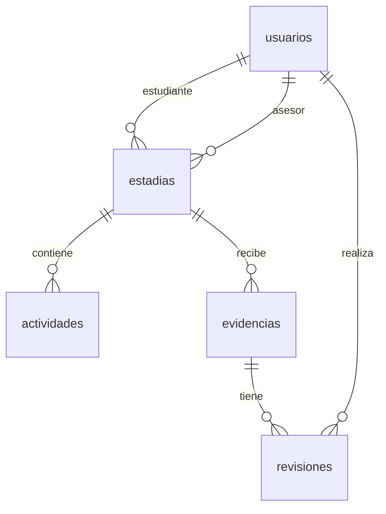
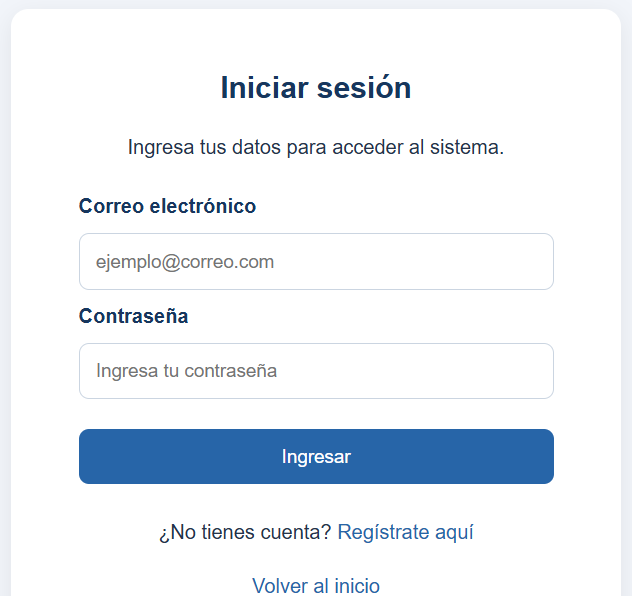

# Portafolio de Análisis y Diseño de Software

**Asignatura:** Ingeniería de Software  
**Unidad:** 2 - Análisis y Diseño de Sistemas  
**Proyecto:** Sistema de Gestión y Seguimiento de Estadías Profesionales  
**Integrantes:** Arely Rodríguez Vargas y Eder Nieto Aguilar  
**Versión:** v2.0-u2

---

## Introducción

El presente portafolio reúne los documentos de análisis y diseño elaborados durante la Unidad 2 de Ingeniería de Software.

Nuestro proyecto consiste en desarrollar una plataforma web que permita a los estudiantes universitarios registrar sus estadías profesionales, llevar un control de sus actividades y entregar evidencias de sus avances.

También permitirá que los asesores académicos revisen los documentos, realicen observaciones y aprueben las entregas.

El objetivo de este portafolio es comprobar que los requisitos del sistema estén relacionados con los diagramas UML, la arquitectura y el diseño de la base de datos.

---

## 1. Factibilidad y Planificación

Durante esta etapa se analizaron los recursos necesarios para desarrollar el Sistema de Gestión y Seguimiento de Estadías Profesionales.

### 1.1 Estudio de Factibilidad

Se evaluaron tres aspectos principales:

| Tipo de Factibilidad | Descripción |
|---|---|
| Técnica | El proyecto es viable porque podemos utilizar Python, Flask, HTML, CSS y SQLite. |
| Económica | Se utilizarán herramientas gratuitas y computadoras disponibles para los integrantes. |
| Operativa | El sistema facilitará el seguimiento de actividades y entregas de los estudiantes durante sus estadías. |

### 1.2 Planificación del Proyecto

Se elaboró un cronograma de Gantt utilizando Mermaid para organizar las actividades de análisis, diseño, desarrollo y pruebas.

También se creó una matriz RACI para distribuir las responsabilidades entre los integrantes del equipo.

El tiempo total estimado de trabajo es de 74 horas, con un costo académico equivalente de $7,400 MXN. Esta cantidad representa una estimación del esfuerzo y no un pago real.

**Documento completo:** [Factibilidad y Planificación](docs/FACTIBILIDAD_PLANIFICACION.md).

---

## 2. Especificación de Requisitos IEEE 830

Se definieron los requisitos funcionales y no funcionales del sistema, considerando las necesidades de estudiantes y asesores académicos.

### 2.1 Requisitos Funcionales

Los requisitos funcionales describen las acciones que deberá realizar el sistema.

| Código | Requisito Funcional | Historia de Usuario | Caso de Uso |
|---|---|---|---|
| RF-01 | Registro de usuarios | HU-01 | CU-01 |
| RF-02 | Inicio de sesión | HU-02 | CU-02 |
| RF-03 | Registro de estadías profesionales | HU-03 | CU-03 |
| RF-04 | Registro de actividades | HU-04 | CU-04 |
| RF-05 | Entrega de evidencias | HU-05 | CU-05 |
| RF-06 | Revisión de entregas | HU-06 | CU-06 |

Estos seis requisitos representan las funciones principales que se desarrollarán en la plataforma.

### 2.2 Requisitos No Funcionales

Los requisitos no funcionales establecen las condiciones de calidad que deberá cumplir el sistema, tomando como referencia ISO/IEC 25010.

| Código | Característica de Calidad | Criterio Propuesto |
|---|---|---|
| RNF-01 | Rendimiento | El sistema deberá responder en un máximo de 2 segundos con 20 usuarios concurrentes durante las pruebas. |
| RNF-02 | Seguridad | Las contraseñas estarán protegidas mediante hash y se utilizarán permisos según el tipo de usuario. |
| RNF-03 | Mantenibilidad | Se utilizará PEP 8 y se buscará alcanzar un 80% de cobertura de pruebas unitarias. |
| RNF-04 | Usabilidad | Al menos 4 de cada 5 usuarios de prueba deberán completar las tareas principales sin ayuda. |
| RNF-05 | Confiabilidad | El sistema deberá validar los datos y evitar registros incompletos o inconsistentes. |

Estas condiciones son objetivos que deberán comprobarse durante el desarrollo y las pruebas del sistema.

**Documento completo:** [Especificación de Requisitos SRS](docs/SRS_IEEE830.md).

---

## 3. Modelado UML Completo

Para representar el funcionamiento y la estructura del sistema, se elaboraron diferentes diagramas UML.

### 3.1 Diagrama de Casos de Uso

El diagrama de casos de uso representa las funciones que podrán realizar los estudiantes y asesores académicos.

Se identificaron seis casos de uso principales:

1. CU-01: Registro de usuario.
2. CU-02: Inicio de sesión.
3. CU-03: Registro de estadía profesional.
4. CU-04: Registro de actividades.
5. CU-05: Entrega de evidencias.
6. CU-06: Revisión y aprobación de evidencias.

Cada caso de uso está relacionado con un requisito funcional.

### 3.2 Diagramas de Secuencia

Los diagramas de secuencia permiten representar el orden de las acciones y la comunicación entre los componentes del sistema.

Se documentaron los procesos de:

- Registro de usuarios.
- Inicio de sesión.
- Registro de estadías.
- Registro de actividades.
- Entrega de evidencias.
- Revisión de evidencias.

Estos diagramas muestran cómo interactúan los usuarios, la página web, el servidor Flask y la base de datos.

### 3.3 Diagrama de Clases

El sistema cuenta con cinco clases principales:

| Clase | Descripción |
|---|---|
| Usuario | Almacena la información de estudiantes y asesores académicos. |
| Estadia | Contiene la información de la empresa, proyecto y asesores asignados. |
| Actividad | Registra las actividades realizadas durante las estadías. |
| Evidencia | Guarda la información de los documentos entregados. |
| Revision | Registra las observaciones y decisiones de los asesores. |

El diagrama de clases incluye atributos, métodos, tipos de datos, visibilidad y multiplicidades.

### 3.4 Diagrama de Componentes y Despliegue

El sistema estará organizado mediante una arquitectura de tres capas:

- **Presentación:** Interfaz web desarrollada con HTML y CSS.
- **Lógica de negocio:** Funciones y rutas de Python con Flask.
- **Datos:** Base de datos SQLite y almacenamiento de documentos.

Para la primera versión se propone utilizar un entorno local de pruebas.

En una versión futura se podría utilizar un servidor para permitir el acceso desde diferentes computadoras de la universidad.

**Documentos completos:**

- [Casos de Uso y Diagramas de Secuencia](docs/SRS_IEEE830.md).
- [Modelado UML](docs/MODELADO_UML.md).

---

## 4. Diseño de Base de Datos

Se diseñó una base de datos relacional utilizando SQLite para almacenar la información del sistema.

### 4.1 Tablas Principales

La base de datos está formada por cinco tablas:

| Tabla | Información |
|---|---|
| usuarios | Datos personales y cuentas de estudiantes y asesores. |
| estadias | Información de empresas, proyectos y asesores asignados. |
| actividades | Bitácoras de actividades de los estudiantes. |
| evidencias | Información de los documentos entregados. |
| revisiones | Observaciones, aprobaciones y solicitudes de corrección. |

### 4.2 Relaciones entre Tablas

Las relaciones principales son:

1. Un estudiante puede registrar varias estadías.
2. Un asesor puede supervisar varias estadías.
3. Una estadía puede contener varias actividades.
4. Una estadía puede tener varias evidencias.
5. Una evidencia puede recibir varias revisiones.
6. Un asesor puede realizar varias revisiones.

### 4.3 Diagrama Entidad-Relación

### 4.4 Integridad de los Datos

Las tablas utilizan las siguientes restricciones:

- **PRIMARY KEY:** Identifica cada registro.
- **FOREIGN KEY:** Relaciona las tablas.
- **NOT NULL:** Evita que falten datos obligatorios.
- **UNIQUE:** Impide registrar correos duplicados.
- **CHECK:** Restringe los valores permitidos.

Se comprobó que el script SQL permite crear las cinco tablas correctamente.

También se realizó una prueba de llave foránea, en la que SQLite impidió registrar una actividad relacionada con una estadía inexistente.

### 4.5 Correspondencia entre UML y SQLite

| Clase UML | Tabla SQLite | Resultado |
|---|---|---|
| Usuario | usuarios | Coinciden los campos principales |
| Estadia | estadias | Coinciden los campos principales |
| Actividad | actividades | Coinciden los campos principales |
| Evidencia | evidencias | Coinciden los campos principales |
| Revision | revisiones | Coinciden los campos principales |

Se identificó una diferencia en la representación de las fechas, ya que UML utiliza el tipo `date` y SQLite utiliza `TEXT` con el formato propuesto `AAAA-MM-DD`.

**Documentos completos:**

- [Diseño de Base de Datos](docs/DISEÑO_BD.md).
- [Script SQL](database/schema.sql).

---

## 5. Arquitectura e Interfaces

### 5.1 Patrón Arquitectónico Seleccionado

Se seleccionó una arquitectura de tres capas organizada mediante los principios del patrón Modelo-Vista-Controlador (MVC).

Este enfoque permite separar las funciones del sistema para facilitar su desarrollo y mantenimiento.

### Modelo

Se encargará de administrar la información almacenada en SQLite.

### Vista

Será la interfaz web que utilizarán los estudiantes y asesores, desarrollada mediante HTML y CSS.

### Controlador

Recibirá las solicitudes de los usuarios, validará la información y coordinará las operaciones mediante Python y Flask.

### 5.2 Endpoints HTTP

Se definieron las siguientes rutas para las funciones principales del sistema:

| Requisito | Operación Propuesta | Método HTTP | Endpoint |
|---|---|---|---|
| RF-01 | registrar_usuario() | POST | /registro |
| RF-02 | iniciar_sesion() | POST | /login |
| RF-03 | registrar_estadia() | POST | /estadias |
| RF-04 | registrar_actividad() | POST | /actividades |
| RF-05 | subir_evidencia() | POST | /evidencias |
| RF-06 | revisar_evidencia() | PUT | /evidencias/{id}/revision |

Los endpoints forman parte del diseño propuesto y todavía no se encuentran implementados en su totalidad.

### 5.3 Wireframes UI/UX

Se documentaron los diseños de las pantallas principales del sistema.

Las pantallas consideradas son:

1. Página principal.
2. Inicio de sesión.
3. Panel del estudiante.
4. Registro de actividades.
5. Entrega de evidencias.
6. Panel del asesor académico.

Los wireframes permiten organizar los menús, formularios y botones antes de implementar las funciones correspondientes.

### Pantalla Principal

La página principal mostrará el nombre del sistema y las opciones para iniciar sesión o registrarse.

### Pantalla de Inicio de Sesión

Permitirá ingresar con correo institucional y una contraseña propia del sistema.

Las imágenes anteriores son capturas de las pantallas iniciales desarrolladas con Flask.

Los paneles del estudiante y del asesor todavía son propuestas de diseño.

**Documentos completos:**

- [Arquitectura y Diseño](docs/ARQUITECTURA_DISENO.md).
- [Wireframes UI/UX](docs/WIREFRAMES_UI_UX.md).

---

## 6. Matriz de Trazabilidad de Requisitos

La trazabilidad permite comprobar que cada requisito funcional está relacionado con los elementos correspondientes del diseño.

| Requisito | Historia | Caso de Uso | Clases Relacionadas | Tablas SQL |
|---|---|---|---|---|
| RF-01 | HU-01 | CU-01 | Usuario | usuarios |
| RF-02 | HU-02 | CU-02 | Usuario | usuarios |
| RF-03 | HU-03 | CU-03 | Usuario, Estadia | usuarios, estadias |
| RF-04 | HU-04 | CU-04 | Estadia, Actividad | estadias, actividades |
| RF-05 | HU-05 | CU-05 | Estadia, Evidencia | estadias, evidencias |
| RF-06 | HU-06 | CU-06 | Usuario, Evidencia, Revision | usuarios, evidencias, revisiones |

Esta matriz permite identificar qué elementos del sistema se relacionan con cada función.

También facilita revisar el impacto de los cambios durante el desarrollo.

---

## 7. Auditoría de Consistencia entre Modelos

Se realizó una revisión documental preliminar para comprobar la correspondencia entre los requisitos, diagramas UML, arquitectura y base de datos.

| Criterio de Auditoría | Resultado | Observaciones |
|---|---|---|
| Los seis RF tienen casos de uso identificados. | Cumple | RF-01 a RF-06 se relacionan con CU-01 a CU-06. |
| Los seis RF cuentan con diagramas de secuencia. | Cumple | Se documentaron los procesos correspondientes. |
| Las cinco clases tienen tablas SQL relacionadas. | Cumple | Usuario, Estadia, Actividad, Evidencia y Revision. |
| El esquema SQL utiliza llaves primarias y foráneas. | Cumple | Se definieron las relaciones correspondientes. |
| Los RNF incluyen criterios de calidad. | Cumple parcialmente | Algunas métricas necesitan mayor precisión. |
| Los atributos UML coinciden con las tablas SQL. | Cumple con observaciones | Las fechas utilizan diferentes representaciones. |
| Los controladores tienen endpoints HTTP propuestos. | Cumple a nivel de diseño | Todavía falta implementarlos y probarlos. |
| Los documentos están organizados. | Cumple | Los documentos de la Unidad 2 se encuentran en la carpeta docs. |
| Se realizó una revisión con otro equipo. | Pendiente | Falta registrar las observaciones de una revisión externa. |

### 7.1 Observaciones

Durante la revisión se comprobó que los requisitos funcionales tienen relación con los casos de uso, diagramas de secuencia, clases y tablas de la base de datos.

También se identificaron algunos aspectos que deben mejorarse:

1. Verificar durante el desarrollo que los usuarios tengan los permisos correspondientes.
2. Comprobar que las fechas se almacenen correctamente.
3. Fortalecer las métricas de los requisitos no funcionales.
4. Implementar y probar los endpoints HTTP.
5. Realizar una revisión cruzada con otro equipo.
6. Completar los dibujos de baja fidelidad de las pantallas pendientes.

Estas actividades permitirán mejorar la consistencia del sistema antes de finalizar su implementación.

---

## 8. Estado Actual del Proyecto

Actualmente se cuenta con:

- Documentación de análisis y diseño.
- Historias de usuario.
- Requisitos funcionales y no funcionales.
- Diagramas UML.
- Diseño de base de datos.
- Script SQL.
- Arquitectura propuesta.
- Página principal desarrollada con Flask.
- Formulario inicial de inicio de sesión.
- Documentación de wireframes.

Todavía falta implementar la autenticación con SQLite, los módulos de estudiantes y asesores, el registro de actividades y la gestión de evidencias.

---

## 9. Conclusión

La elaboración de este portafolio permitió reunir los documentos de análisis y diseño del Sistema de Gestión y Seguimiento de Estadías Profesionales.

Mediante los requisitos, diagramas UML, arquitectura y base de datos se estableció una estructura inicial para desarrollar el software.

También se comprobó la relación entre los diferentes elementos del diseño y se identificaron aspectos que necesitan mejoras.

Este trabajo servirá como base para continuar con el desarrollo de la plataforma utilizando Python, Flask y SQLite.