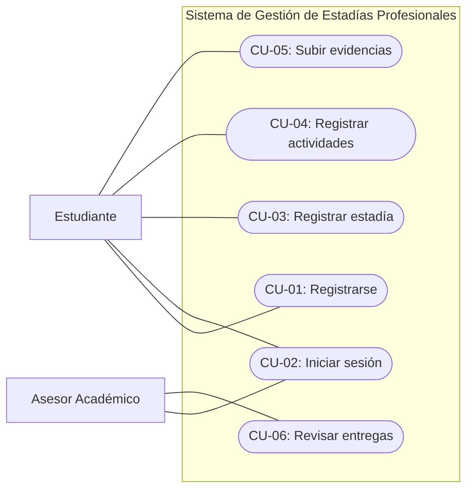
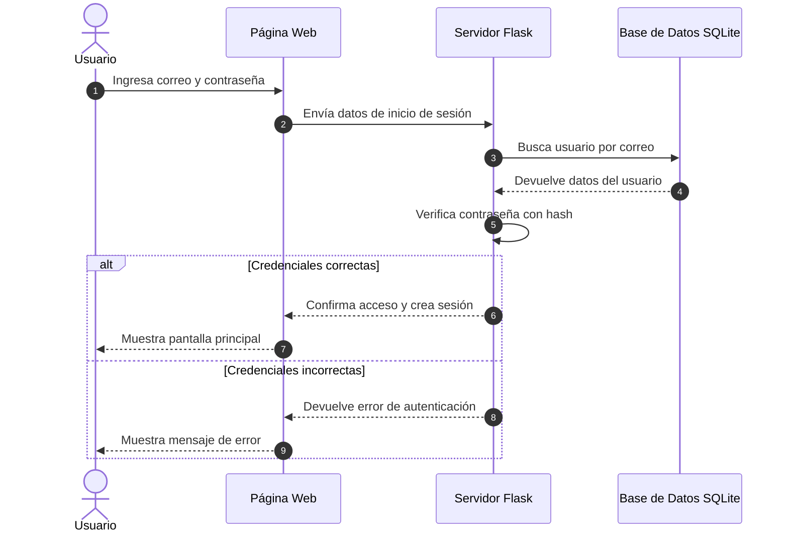

# Especificación de Requisitos de Software (SRS) - IEEE Std 830-1998

**Asignatura:** Ingeniería de Software
**Unidad:** 2 - Análisis y Diseño de Sistemas de Software
**Proyecto:** Sistema de Gestión y Seguimiento de Estadías Profesionales
**Integrantes:** Arely Rodríguez Vargas y Eder Nieto Aguilar

## 1. Introducción y Propósito

El presente documento tiene como propósito definir los requisitos del Sistema de Gestión y Seguimiento de Estadías Profesionales.

El sistema se propone como una plataforma web que facilite la organización y supervisión de las actividades realizadas por los estudiantes durante sus estadías profesionales.

También permitirá que los asesores académicos consulten los avances, revisen los documentos entregados y proporcionen observaciones.

La especificación de requisitos servirá como guía para el diseño, desarrollo y pruebas del sistema.

### 1.1 Alcance del Sistema

El sistema estará dirigido principalmente a estudiantes universitarios y asesores académicos.

Los estudiantes podrán registrarse, iniciar sesión, registrar los datos de sus estadías profesionales, llevar una bitácora de actividades y subir reportes o evidencias.

Los asesores podrán consultar las entregas de sus estudiantes asignados, revisar documentos, aprobarlos o solicitar correcciones.

La plataforma también permitirá consultar el historial de actividades y el estado de las entregas.

Para la primera versión, el sistema se desarrollará como una aplicación web utilizando Python, Flask, HTML, CSS y SQLite.

El sistema no incluirá inicialmente una aplicación móvil ni una integración automática con la plataforma institucional existente. Estas funciones podrían considerarse en futuras versiones.

## 2. Requerimientos Funcionales (RF)

Los requerimientos funcionales describen las acciones que el Sistema de Gestión y Seguimiento de Estadías Profesionales deberá realizar para satisfacer las necesidades de estudiantes y asesores académicos.

| Código | Nombre del Requisito | Descripción | Prioridad | Actor Principal |
|---|---|---|---|---|
| RF-01 | Registro de Usuarios | El sistema permitirá registrar estudiantes mediante un formulario con sus datos personales y académicos. | Alta | Estudiante |
| RF-02 | Inicio de Sesión | El sistema permitirá que estudiantes y asesores inicien sesión con su correo electrónico y contraseña, mostrando las funciones correspondientes a su rol. | Alta | Estudiante / Asesor |
| RF-03 | Registro de Estadías | El sistema permitirá registrar la empresa, el nombre del proyecto y los asesores asignados a la estadía profesional. | Alta | Estudiante |
| RF-04 | Registro de Actividades | El sistema permitirá registrar las actividades realizadas durante la estadía, incluyendo fecha y descripción. | Alta | Estudiante |
| RF-05 | Entrega de Evidencias | El sistema permitirá subir documentos y reportes relacionados con las actividades realizadas. | Alta | Estudiante |
| RF-06 | Revisión de Entregas | El sistema permitirá que los asesores revisen las evidencias, aprueben entregas o soliciten correcciones mediante observaciones. | Alta | Asesor Académico |

### Relación con las Historias de Usuario

Los requerimientos funcionales están relacionados con las historias de usuario definidas anteriormente:

- RF-01 corresponde a HU-01: Registro de usuario.
- RF-02 corresponde a HU-02: Inicio de sesión.
- RF-03 corresponde a HU-03: Registro de estadía profesional.
- RF-04 corresponde a HU-04: Registro de actividades de estadía.
- RF-05 corresponde a HU-05: Entrega de reportes y evidencias.
- RF-06 corresponde a HU-06: Revisión y aprobación de evidencias.

Esta relación permitirá comprobar que las funciones desarrolladas cumplen con las necesidades identificadas durante el análisis del proyecto.

## 3. Requerimientos No Funcionales (RNF - ISO/IEC 25010)

Los requerimientos no funcionales establecen las condiciones de calidad que deberá cumplir el Sistema de Gestión y Seguimiento de Estadías Profesionales.

**RNF-01: Rendimiento**

El sistema deberá responder a las consultas y operaciones principales en un tiempo máximo de 2 segundos bajo una carga de prueba de 20 usuarios concurrentes.

**RNF-02: Seguridad**

El sistema deberá proteger los datos personales y académicos de los usuarios mediante autenticación, contraseñas almacenadas con hash seguro y permisos de acceso según el rol de estudiante o asesor.

Para su despliegue en un servidor se utilizará HTTPS, con el fin de proteger la información transmitida.

**RNF-03: Mantenibilidad**

El código deberá estar organizado en módulos y seguir las convenciones de programación PEP 8. Se utilizará Flake8 para revisar el estilo del código y se buscará alcanzar al menos un 80% de cobertura de pruebas unitarias en los módulos principales.

**RNF-04: Usabilidad**

La plataforma deberá contar con una interfaz sencilla y organizada, permitiendo que los estudiantes registren sus actividades y que los asesores revisen las evidencias sin procedimientos complicados.

Durante las pruebas se verificará que al menos 4 de cada 5 usuarios de prueba puedan completar las tareas principales sin ayuda.

**RNF-05: Confiabilidad**

El sistema deberá validar la información antes de guardarla y mostrar mensajes claros cuando ocurra un error.

También deberá evitar la pérdida de información ante entradas incorrectas o fallos durante el registro de actividades y documentos.

## 4. Diagrama de Casos de Uso (Mermaid) y Descripción Tabular

El siguiente diagrama representa las funciones principales que podrán realizar los estudiantes y asesores académicos dentro del sistema.

### Descripción de los Casos de Uso

| Código | Caso de Uso | Actor | Descripción | Resultado Esperado |
|---|---|---|---|---|
| CU-01 | Registrarse | Estudiante | El estudiante registra sus datos personales y académicos. | Usuario registrado correctamente. |
| CU-02 | Iniciar sesión | Estudiante / Asesor | El usuario ingresa sus credenciales. | Acceso a las funciones correspondientes. |
| CU-03 | Registrar estadía | Estudiante | Registra la empresa, proyecto y asesores asignados. | Estadía almacenada en el sistema. |
| CU-04 | Registrar actividades | Estudiante | Registra las actividades realizadas durante sus estadías. | Actividad guardada en la bitácora. |
| CU-05 | Subir evidencias | Estudiante | Carga documentos y reportes de sus actividades. | Evidencia registrada correctamente. |
| CU-06 | Revisar entregas | Asesor | Consulta evidencias, las aprueba o solicita correcciones. | Estado de la entrega actualizado. |

## 5. Diagrama de Secuencia UML

El siguiente diagrama representa el proceso de inicio de sesión de un estudiante o asesor académico.

El usuario ingresa su correo electrónico y contraseña. El sistema consulta la información en la base de datos y verifica que las credenciales sean correctas antes de permitir el acceso.

### Descripción del Proceso

1. El estudiante o asesor ingresa su correo y contraseña.
2. La página web envía los datos al servidor Flask.
3. El servidor consulta la base de datos SQLite para buscar al usuario.
4. El sistema verifica que la contraseña corresponda con el hash almacenado.
5. Si los datos son correctos, se inicia una sesión y se permite el acceso.
6. Si son incorrectos, se muestra un mensaje de error y no se permite ingresar.

Este proceso permitirá controlar el acceso al sistema de acuerdo con el tipo de usuario.
