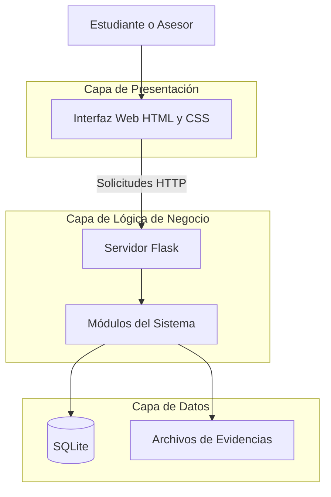

# Arquitectura y Diseño del Sistema de Software

**Asignatura:** Ingeniería de Software  
**Unidad:** 2 - Análisis y Diseño de Sistemas  
**Proyecto:** Sistema de Gestión y Seguimiento de Estadías Profesionales  
**Integrantes:** Arely Rodríguez Vargas y Eder Nieto Aguilar  

## 1. Introducción

El presente documento describe la arquitectura propuesta para el Sistema de Gestión y Seguimiento de Estadías Profesionales.

La plataforma permitirá que los estudiantes registren sus estadías, actividades y evidencias, mientras que los asesores académicos podrán revisar los documentos, aprobar entregas y solicitar correcciones.

Para facilitar el desarrollo y mantenimiento del sistema, se propone utilizar una arquitectura de tres capas y una organización basada en el patrón Modelo-Vista-Controlador (MVC).

## 2. Patrón Arquitectónico Seleccionado

Se seleccionó una arquitectura de tres capas, organizada mediante los principios del patrón Modelo-Vista-Controlador (MVC).

Este enfoque permite separar la presentación de la información, el procesamiento de las funciones y el almacenamiento de los datos.

### Modelo (Model)

Se encargará de administrar y consultar la información almacenada en SQLite.

Las entidades principales serán:

- Usuario
- Estadia
- Actividad
- Evidencia
- Revision

### Vista (View)

Será la interfaz que utilizarán los estudiantes y asesores académicos.

Se desarrollará utilizando HTML y CSS mediante las plantillas de Flask.

Entre las pantallas propuestas se encuentran:

- Página principal.
- Registro de usuarios.
- Inicio de sesión.
- Panel del estudiante.
- Registro de estadías.
- Bitácora de actividades.
- Entrega de evidencias.
- Panel del asesor.

### Controlador (Controller)

Recibirá las solicitudes de los usuarios, comprobará los datos y coordinará las operaciones del sistema.

Se implementará utilizando rutas y funciones de Python con Flask.

Por ejemplo, cuando un estudiante registre una actividad, el controlador validará la información y solicitará su almacenamiento en la base de datos.

## 3. Arquitectura de Tres Capas

El sistema se organizará en tres capas principales:

1. **Presentación:** Interfaz web desarrollada con HTML y CSS.
2. **Lógica de negocio:** Funciones y rutas de Python con Flask.
3. **Datos:** Base de datos SQLite y almacenamiento de documentos.

### Diagrama de Arquitectura

### Justificación

Esta arquitectura permitirá organizar el código en componentes separados, facilitar las pruebas y realizar modificaciones sin afectar innecesariamente otras partes del sistema.

También facilitará agregar nuevas funcionalidades en versiones posteriores.

## 4. Diseño de API REST

Se propone utilizar rutas HTTP para comunicar la interfaz web con las funciones del servidor Flask.

Los endpoints siguientes representan el diseño previsto del sistema.

| Método HTTP | Endpoint | Función | Usuario |
|---|---|---|---|
| POST | /registro | Registrar un estudiante | Estudiante |
| POST | /login | Iniciar sesión | Estudiante / Asesor |
| GET | /estadias | Consultar estadías autorizadas | Estudiante / Asesor |
| POST | /estadias | Registrar una estadía | Estudiante |
| GET | /actividades | Consultar actividades | Estudiante |
| POST | /actividades | Registrar una actividad | Estudiante |
| POST | /evidencias | Subir una evidencia | Estudiante |
| GET | /evidencias | Consultar evidencias autorizadas | Estudiante / Asesor |
| PUT | /evidencias/{id}/revision | Aprobar o solicitar correcciones | Asesor |
| DELETE | /actividades/{id} | Eliminar una actividad permitida | Estudiante |

### Uso de los Métodos HTTP

- **GET:** Consultar información.
- **POST:** Crear registros o enviar información.
- **PUT:** Actualizar información existente.
- **DELETE:** Eliminar registros autorizados.

Los endpoints deberán validar la identidad y los permisos del usuario antes de acceder o modificar información.

Las rutas presentadas son propuestas de diseño. Todavía no se encuentran implementadas en su totalidad.

## 5. Seguridad del Sistema

Para proteger los datos personales y académicos de los estudiantes, se establecerán las siguientes medidas:

- Autenticación mediante correo institucional y una contraseña propia del sistema.
- Almacenamiento de contraseñas mediante hashes seguros.
- Validación de formularios.
- Control de acceso según el rol de estudiante o asesor.
- Protección de los documentos y evidencias almacenados.
- Restricción del acceso a información de otros estudiantes.
- Uso de HTTPS cuando la aplicación se publique en un servidor.

La plataforma no solicitará las contraseñas utilizadas en SIINE, ya que no se cuenta con una integración institucional autorizada.

## 6. Tecnologías Seleccionadas

| Tecnología | Uso |
|---|---|
| Python | Programación del sistema |
| Flask | Desarrollo del servidor web |
| HTML | Estructura de las páginas |
| CSS | Diseño visual |
| SQLite | Almacenamiento de información |
| Git | Control de versiones |
| GitHub | Colaboración y revisión de cambios |
| Visual Studio Code | Entorno de desarrollo |

## 7. Conclusión

La arquitectura propuesta permitirá desarrollar el Sistema de Gestión y Seguimiento de Estadías Profesionales de manera organizada y progresiva.

La separación entre presentación, lógica de negocio y datos facilitará el mantenimiento, las pruebas y la incorporación de nuevas funciones.

Además, el uso de Flask, SQLite y herramientas gratuitas permitirá desarrollar un prototipo académico sin necesidad de adquirir infraestructura adicional.