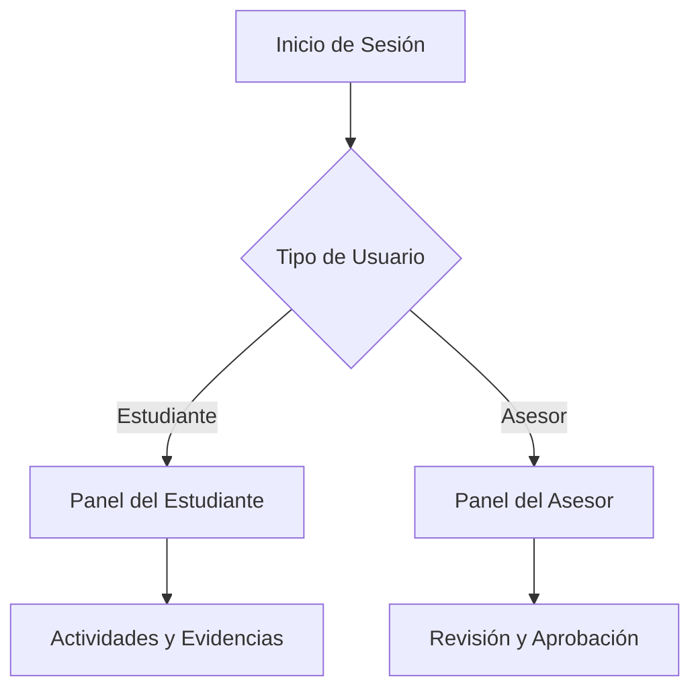

# Wireframes UI/UX del Sistema

**Proyecto:** Sistema de Gestión y Seguimiento de Estadías Profesionales

**Integrantes:** Arely Rodríguez Vargas y Eder Nieto Aguilar

## 1. Introducción

Los wireframes permiten representar la estructura inicial de las pantallas del sistema antes de comenzar su desarrollo.

Se propone una interfaz sencilla y organizada para facilitar el uso de la plataforma por parte de estudiantes y asesores académicos.

## 2. Pantalla de Inicio de Sesión

Esta pantalla permitirá que los usuarios ingresen utilizando su correo institucional y la contraseña creada para el sistema.

### Elementos de la Pantalla

| Elemento | Descripción |
|---|---|
| Encabezado | Nombre del Sistema de Estadías Profesionales |
| Correo institucional | Campo para ingresar el correo del usuario |
| Contraseña | Campo para ingresar la contraseña |
| Iniciar sesión | Botón para acceder |
| Registrarse | Enlace para crear una cuenta |
| Recuperar contraseña | Opción propuesta para recuperar el acceso |

### Funcionamiento

El usuario ingresa su correo institucional y contraseña.

El sistema valida los datos y permite ingresar al panel correspondiente, dependiendo de si es estudiante o asesor.

## 3. Panel Principal del Estudiante

Esta pantalla mostrará las funciones disponibles para el estudiante.

### Elementos de la Pantalla

| Sección | Función |
|---|---|
| Inicio | Mostrar un resumen de la estadía |
| Mi estadía | Consultar información de la empresa y proyecto |
| Actividades | Registrar y consultar actividades |
| Evidencias | Subir reportes y documentos |
| Estado de entregas | Consultar documentos aprobados o pendientes |
| Cerrar sesión | Salir del sistema |

### Funcionamiento

Después de iniciar sesión, el estudiante podrá consultar su estadía y acceder a las diferentes funciones mediante un menú de navegación.

## 4. Pantalla de Registro de Actividades

Permitirá registrar las actividades realizadas durante las estadías profesionales.

### Elementos de la Pantalla

| Campo | Descripción |
|---|---|
| Fecha | Fecha de realización de la actividad |
| Descripción | Explicación de la actividad realizada |
| Guardar | Botón para registrar la actividad |
| Historial | Lista de actividades registradas |

### Funcionamiento

El estudiante selecciona una fecha, escribe la descripción de la actividad y presiona Guardar.

El sistema valida los datos y almacena la información en la base de datos.

## 5. Pantalla de Entrega de Evidencias

Permitirá que los estudiantes suban documentos relacionados con sus actividades.

### Elementos de la Pantalla

| Elemento | Función |
|---|---|
| Seleccionar archivo | Elegir un documento |
| Subir evidencia | Enviar el archivo |
| Historial de evidencias | Consultar documentos entregados |
| Estado | Mostrar si está pendiente, aprobado o requiere corrección |
| Observaciones | Consultar comentarios del asesor |

### Funcionamiento

El estudiante selecciona un documento y lo envía.

El sistema valida el archivo, guarda su información y lo deja pendiente de revisión.

## 6. Panel del Asesor Académico

Esta pantalla permitirá que los asesores revisen las actividades y evidencias de sus estudiantes asignados.

### Elementos de la Pantalla

| Sección | Función |
|---|---|
| Estudiantes asignados | Consultar estudiantes bajo su supervisión |
| Actividades | Revisar bitácoras de trabajo |
| Evidencias | Consultar documentos entregados |
| Aprobar | Autorizar una entrega |
| Solicitar corrección | Registrar observaciones |
| Historial | Consultar revisiones anteriores |

### Funcionamiento

El asesor selecciona un estudiante, consulta sus evidencias y revisa los documentos.

Después puede aprobar la entrega o solicitar modificaciones mediante observaciones.

## 7. Navegación del Sistema

El siguiente diagrama representa la navegación principal de la plataforma.

## 8. Consideraciones de Diseño

Para desarrollar las interfaces se considerarán los siguientes aspectos:

- Utilizar colores y botones consistentes.
- Mostrar mensajes claros al guardar información.
- Mantener una navegación sencilla.
- Adaptar las pantallas a computadoras y dispositivos móviles.
- Proteger la información según el tipo de usuario.
- Facilitar la consulta de actividades y evidencias.

## 9. Conclusión

Los wireframes permiten establecer la estructura inicial de las pantallas del sistema.

Este diseño ayudará a organizar las funciones y facilitará el desarrollo de la interfaz web con HTML, CSS y Flask.